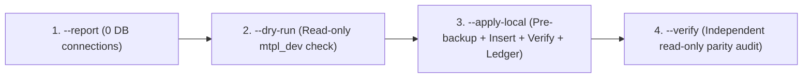

# MTPL P2.0 — Package Catalogue Migration Runbook (Local Development Only)

**Milestone:** Phase 2 — P2.0  
**Target Scope:** Local Docker MongoDB (`mtpl_dev` on `127.0.0.1` / `localhost` / `::1`) **ONLY**  
**Script:** [`scripts/migrate-packages-to-mongodb.ts`](file:///f:/Navkar%20Logic%20Client%20Projects/mtpl-travel-platform/scripts/migrate-packages-to-mongodb.ts)  
**Rollback Guide:** [`docs/P2_PACKAGE_ROLLBACK_RUNBOOK.md`](file:///f:/Navkar%20Logic%20Client%20Projects/mtpl-travel-platform/docs/P2_PACKAGE_ROLLBACK_RUNBOOK.md)

---

## 1. Hard Safety Guardrails

1. **Local Database Only (`mtpl_dev`):**
   - `NODE_ENV=production` and `NEXT_PUBLIC_ENVIRONMENT=production` are rejected immediately.
   - `mongodb+srv://`, remote hostnames, non-loopback IPs, missing database paths, `test`, production DB names, and any DB name other than `mtpl_dev` are blocked.
   - Credential values in `MONGODB_URI` are redacted (`****:****@`) in logs.
   - There are **zero** remote override flags (`--allow-remote`, `--apply`, and `--rollback` are permanently rejected).
2. **Non-Overwriting Idempotency:**
   - Before writing, `analyzeMigrationPlan` computes canonical digests comparing source data against any existing DB records.
   - Identical existing documents are skipped idempotently.
   - Any differing existing `Package` or `MediaAsset` triggers a **`CONFLICT ABORT`** before any database mutation occurs.
   - Writes use `updateOne(..., { $setOnInsert: ... }, { upsert: true })`, guaranteeing existing documents are never overwritten.
3. **Filesystem Safety:**
   - Recursive scan of `storage/media/public/` rejects symbolic links (`lstatSync`) and boundary escapes (`realpathSync`).
   - Unknown or corrupt binary content blocks execution instead of logging a warning.
   - Physical files are never renamed, moved, converted, or deleted.

---

## 2. Pre-Migration Checklist

1. Confirm local Docker MongoDB container (`mtpl-mongodb`) is running and healthy (`127.0.0.1:27017`).
2. Confirm `.env.local` defines `MONGODB_URI` pointing to local `127.0.0.1:27017/mtpl_dev` and `NODE_ENV` is not `production`.
3. Run static TypeScript check and automated test suite (tests use read-only source checks plus a temporary isolated `mtpl_p2_test_<timestamp>` DB that is dropped afterward):

```powershell
npx tsc --noEmit
npx tsx scripts/test-package-migration.ts
```

---

## 3. Execution Stages



### Stage 1: Offline Source Audit Report (`--report` — Zero Database Connections)

```powershell
npx tsx scripts/migrate-packages-to-mongodb.ts --report
```

Performs **zero MongoDB connections** (`mongoose.connect` / `createConnection` is never called). Reads only local `packages.ts`, `package-tables.json`, and `storage/media/public/`, and writes [`docs/reports/migration-report.json`](file:///f:/Navkar%20Logic%20Client%20Projects/mtpl-travel-platform/docs/reports/migration-report.json) and [`docs/reports/MIGRATION_REPORT.md`](file:///f:/Navkar%20Logic%20Client%20Projects/mtpl-travel-platform/docs/reports/MIGRATION_REPORT.md) with source counts, true content-detected MIME statistics, and documented discrepancies.

### Stage 2: Strictly Read-Only Database Pre-Flight (`--dry-run` — Zero Writes)

```powershell
npx tsx scripts/migrate-packages-to-mongodb.ts --dry-run
```

Differs from `--report` by opening an **isolated read-only MongoDB connection** (`mongoose.createConnection` with `autoCreate: false` and `autoIndex: false` on all cloned schemas) to local `mtpl_dev` ONLY. It compares `mtpl_dev` collections against the authoritative source and checks `MigrationLedger` for existing, running, or failed ledger records. It **never** creates collections, creates/modifies indexes, inserts documents, writes ledger records, or writes pre-migration snapshots. Exits with code `1` if any content conflicts exist.

### Stage 3: Execute Authorized Local Migration (`--apply-local`)

> [!IMPORTANT]
> Run `--apply-local` only when authorized to populate local `mtpl_dev`. Never execute during validation-only runs.

```powershell
npx tsx scripts/migrate-packages-to-mongodb.ts --apply-local
```

What `--apply-local` performs:
1. Refuses to run if an interrupted `"rolling_back"` ledger exists (`ROLLBACK IN PROGRESS`).
2. Validates local `mtpl_dev` target, runs full conflict pre-flight (`CONFLICT ABORT` before any write if any existing doc differs), and discovers any prior incomplete ledgers (`status: "running" | "failed"`) in the current migration cycle (since the last `"applied"` or `"rolled_back"` boundary).
3. Captures the cycle's pre-existing document baseline (`preExistingPackageSlugs`, `preExistingMediaKeys`) — inherited verbatim from Attempt 1 when recovering — and writes a timestamped pre-migration JSON snapshot to `storage/backups/pre-migration-snapshot-mtpl_dev-<timestamp>.json`.
4. Verifies any prior failed attempt's recorded digests still match the DB state (`CONFLICT ABORT` if mutated), creates a new `MigrationLedger` entry (`status: "running"`) linked to `parentAttemptLedgerIds`, and inserts remaining `MediaAsset` and `Package` documents via `$setOnInsert`.
5. Captures canonical SHA-256 digests for **both** this attempt's inserts (`migratedPackageDigests` / `migratedMediaDigests`) **and** the complete cohort across all attempts in the cycle (`ownedPackageSlugs` / `ownedPackageDigests`, `ownedMediaKeys` / `ownedMediaDigests`, excluding `preExistingPackageSlugs` / `preExistingMediaKeys`), validating 1:1 key-set parity on both.
6. Executes `verifyDatabaseAgainstSource` parity assertions (`11` checks), marks the ledger `"applied"`, and stamps `supersededByLedgerId` onto linked parent attempt ledgers (keeping their audit records intact).

### Stage 4: Independent Post-Migration Verification (`--verify` — Read-Only)

```powershell
npx tsx scripts/migrate-packages-to-mongodb.ts --verify
```

Opens the same read-only connection (`autoCreate: false`, `autoIndex: false`) to `mtpl_dev` and verifies all 93 packages, 186 media assets, category counts (`67`/`26`), itineraries, accommodations/cost tables, and binary SHA-256 digests.

---

## 4. Transaction Limitations, Multi-Attempt Ownership & Failure Recovery

### Standalone MongoDB Transaction Limitation

Local Docker container `mtpl-mongodb` (`mongo:8` in [`docker-compose.yml`](file:///f:/Navkar%20Logic%20Client%20Projects/mtpl-travel-platform/docker-compose.yml)) runs as a standalone single-node instance without `--replSet`. MongoDB multi-document ACID transactions are only supported on replica sets and sharded clusters, not standalone instances. Accordingly, `--apply-local` uses a cohort-linked ledger journal + pre-flight conflict check + idempotent `$setOnInsert` upserts + post-apply verification gate.

### How Failed Attempts Associate with Retries & Ownership

1. **Pre-existing Baseline Preserved:** On Attempt 1 of a cycle, `preExistingPackageSlugs` and `preExistingMediaKeys` capture every key already present in `mtpl_dev` before any migration write occurs. Any subsequent retry in the same cycle inherits Attempt 1's baseline rather than re-capturing it.
2. **Failed / Interrupted Recording:**
   - Caught mid-run failures transition the ledger to `status: "failed"` (never `"applied"`) and record the exact partial `insertedMediaKeys`, `insertedPackageSlugs`, and canonical SHA-256 digests inserted up to the error.
   - Uncaught process crashes (`SIGKILL` / power loss) leave `status: "running"`.
3. **Detection:** Running `npx tsx scripts/migrate-packages-to-mongodb.ts --dry-run` inspects `migrationledgers` read-only and reports any `running`, `failed`, or `rolling_back` ledger counts alongside the remaining un-migrated documents.
4. **Cohort Ownership on Safe Retry (`--apply-local`):** Re-running `--apply-local` before any writes occur:
   - Associates all prior incomplete cycle attempts via `parentAttemptLedgerIds`.
   - Verifies prior partial documents match source and prior digests (`CONFLICT ABORT` if corrupted/edited).
   - Skips prior-attempt matching documents idempotently while inserting remaining records, then records full cycle ownership (`ownedPackageSlugs` / `ownedPackageDigests`, `ownedMediaKeys` / `ownedMediaDigests`) across Attempt 1 + Retry, strictly excluding `preExistingPackageSlugs` / `preExistingMediaKeys`.
   - Even if Attempt 1 failed after all 93 packages / 186 media during post-insert verification (`0` remaining to insert), the retry detects `priorCycleIncompleteLedgers.length > 0` and completes cohort verification + `"applied"` ledger finalization.
   - Supersedes prior failed/running ledgers with `supersededByLedgerId` while keeping every historical ledger record intact.

---

## 5. Troubleshooting

| Symptom | Cause | Resolution |
| :--- | :--- | :--- |
| `SAFETY BLOCK: Remote or non-loopback MongoDB host` | `.env.local` points to Atlas or remote host | Restore `MONGODB_URI` to local `127.0.0.1:27017/mtpl_dev` |
| `Forbidden migration flag` | Legacy `--apply`, `--rollback`, or `--allow-remote` passed | Use explicit `--dry-run`, `--apply-local`, `--verify`, or `--rollback-local` |
| `BLOCKING MEDIA ERROR` | Unknown binary file, missing media on disk, or symlink inside `storage/media/public` | Inspect the reported path on disk before migrating |
| `CONFLICT ABORT` | Existing document in `mtpl_dev` differs from static source | Inspect the conflicting slug/storageKey manually; script refuses to overwrite |
