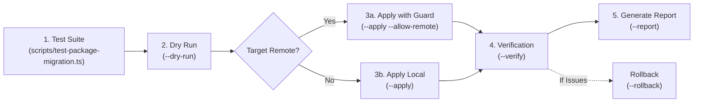

# MTPL Travel Platform — Phase 2: Package Migration Runbook

**Document:** `P2_PACKAGE_MIGRATION_RUNBOOK.md`  
**Milestone:** Phase 2 — P2.0 (MongoDB Package Catalogue Foundation)  
**Target Environment:** Local Docker MongoDB (`mtpl_dev`) / Staging / Production MongoDB Atlas  
**Authoritative Migration Script:** `scripts/migrate-packages-to-mongodb.ts`  
**Test Suite:** `scripts/test-package-migration.ts`

---

## 1. Prerequisites & Environment Check

Before initiating any migration operations:

1. **Node.js & Dependencies:**  
   Ensure Node.js `>= 20.9.0` is active and dependencies are installed (`npm install` or `pnpm install`).
2. **Environment Configuration (`.env.local` / `.env`):**  
   Verify that `MONGODB_URI` points to the intended target database.
   - For local development Docker: `mongodb://<db_user>:<db_pass>@127.0.0.1:27017/mtpl_dev?authSource=admin`
   - For remote MongoDB Atlas: `mongodb+srv://<db_user>:<db_pass>@<cluster>.mongodb.net/<database>?retryWrites=true&w=majority`
3. **Media Storage Root:**  
   Verify that `storage/media/public/` exists and contains 186 media files (91 PDFs and 95 WebP covers).
4. **Offline Test Suite:**  
   Execute the automated test suite to verify schema rules and source integrity before connecting to any live database:
   ```bash
   npx tsx scripts/test-package-migration.ts
   ```
   *Expected result: 31 Passed, 0 Failed.*

---

## 2. Safety & Pre-Migration Backup

### 2.1 Automated Pre-Flight Snapshot
When the migration is executed in `--apply` mode, `migrate-packages-to-mongodb.ts` **automatically** exports an immutable pre-migration JSON snapshot to:
```
storage/backups/pre-migration-snapshot-<timestamp>.json
```
This snapshot captures the exact pre-existing state of both the `packages` and `mediaassets` collections.

### 2.2 Manual MongoDB Dump (Recommended for Production/Staging)
For production or staging clusters, perform an out-of-band `mongodump` before applying changes:
```bash
# Docker local container
docker exec -it mtpl-mongodb mongodump --db mtpl_dev --out /data/db/backup_$(date +%Y%m%d_%H%M%S)

# Remote MongoDB Atlas (using Database Tools)
mongodump --uri="<MONGODB_URI>" --out="./storage/backups/atlas_backup_$(date +%Y%m%d_%H%M%S)"
```

---

## 3. Migration Commands & Execution Sequence



### Stage 1: Generate Inventory Audit Report
Generate the audit reports without touching any database:
```bash
npx tsx scripts/migrate-packages-to-mongodb.ts --report
```
*Outputs:*
- `docs/reports/migration-report.json`
- `docs/reports/MIGRATION_REPORT.md`

### Stage 2: Execute Dry Run (Default)
Perform a non-mutating simulated inspection of the target database:
```bash
npx tsx scripts/migrate-packages-to-mongodb.ts --dry-run
# or simply:
npx tsx scripts/migrate-packages-to-mongodb.ts
```
*Expected Output:*
- Connects to target database.
- Reports target host, active database name, and remote/local mode.
- Identifies 93 packages (67 National, 26 International).
- Identifies 186 media files (91 PDFs, 95 WebPs).
- Calculates inserts vs updates.
- Confirms: `ZERO database writes and ZERO filesystem changes performed.`

### Stage 3: Live Apply Migration
Apply the migration to populate MongoDB:

#### A. For Local Development Database (`localhost` / `127.0.0.1`):
```bash
npx tsx scripts/migrate-packages-to-mongodb.ts --apply
```

#### B. For Remote MongoDB Atlas Cluster:
The script enforces an explicit safety gate to prevent accidental writes to production/cloud clusters. If the connection string is remote, pass `--allow-remote`:
```bash
npx tsx scripts/migrate-packages-to-mongodb.ts --apply --allow-remote
```

*Execution Stages during Apply:*
1. Generates `storage/backups/pre-migration-snapshot-<timestamp>.json`.
2. Creates `MigrationLedger` document with status `'running'`.
3. Backfills 186 `MediaAsset` records into `mediaassets` using `$setOnInsert` safe upserts.
4. Ingests all 93 packages with embedded accommodation and cost tables into `packages`.
5. Updates `MigrationLedger` with status `'applied'`, recording inserted slugs and media keys.
6. Automatically triggers the post-migration verification engine.

---

## 4. Verification & Health Checks

To run post-migration verification independently at any time:
```bash
npx tsx scripts/migrate-packages-to-mongodb.ts --verify
```

### Verification Invariants Enforced:
1. Total package count in MongoDB is **exactly 93**.
2. National package count is **exactly 67**.
3. International package count is **exactly 26**.
4. Published packages count is **exactly 93** (`status='published'`).
5. INR currency count is **67**; USD currency count is **26**.
6. All 93 package hero covers exist in `storage/media/public/`.
7. All 91 non-empty PDF download keys exist on disk.
8. MediaAsset collection has **exactly 186 records** matching disk files.
9. Both Dubai packages have empty PDF keys handled safely without failure.
10. All 93 packages have valid accommodation matrices and cost breakdown tables.

---

## 5. Rollback & Recovery Procedures

If migration verification fails, or if catalogue ingestion must be reverted for any reason:

### 5.1 Automated Rollback Command

#### For Local Database:
```bash
npx tsx scripts/migrate-packages-to-mongodb.ts --rollback
```

#### For Remote Database:
```bash
npx tsx scripts/migrate-packages-to-mongodb.ts --rollback --allow-remote
```

### 5.2 Rollback Safety Guarantees
1. **Targeted Deletion Only:** Deletes *only* the package documents whose slugs are recorded in the active `MigrationLedger.insertedPackageSlugs` array.
2. **MediaAsset Targeted Deletion:** Deletes *only* the `MediaAsset` documents whose keys are recorded in `MigrationLedger.insertedMediaKeys`.
3. **State Restoration:** If any pre-existing package records were updated, restores them from the pre-migration snapshot file.
4. **Physical Media Immutability:** Never deletes or modifies physical files in `storage/media/public/`.
5. **Collection Isolation:** Leaves unrelated collections (`enquiries`, `feedbacks`, `callbackrequests`) completely untouched.
6. **Ledger Audit Update:** Updates the ledger document status to `'rolled_back'` with `rolledBackAt` timestamp.

---

## 6. Troubleshooting Common Issues

| Symptom | Cause | Resolution |
|---|---|---|
| `🛑 SAFETY HALT: Remote MongoDB Cluster Detected!` | The configured `MONGODB_URI` points to a remote host (e.g. Atlas) and `--allow-remote` was not passed. | Review the redacted host and database name printed in the terminal. If confirmed, execute with `--allow-remote`. |
| `Media directory not found at: storage/media/public` | Process was launched from a different working directory. | Ensure the working directory is the repository root: `cd "f:\Navkar Logic Client Projects\mtpl-travel-platform"`. |
| `MongooseServerSelectionError: connect ECONNREFUSED 127.0.0.1:27017` | Local MongoDB container or service is stopped. | Start the local container via `docker compose up -d mongodb` or start the local Windows service. |
| `⚠️ Warning: Magic byte mismatch for media file` | File content does not match expected MIME header. | Inspect file with `scripts/test-package-migration.ts`. Note that 88 files named `.webp` contain binary PNG data, which the migration script handles accurately. |
| `E11000 duplicate key error collection: packages index: slug_1` | A package document with the same slug already exists from an external write. | Run `--dry-run` to inspect conflict. The migration uses `updateOne({ slug }, { $set }, { upsert: true })` during apply to handle re-runs idempotently. |

